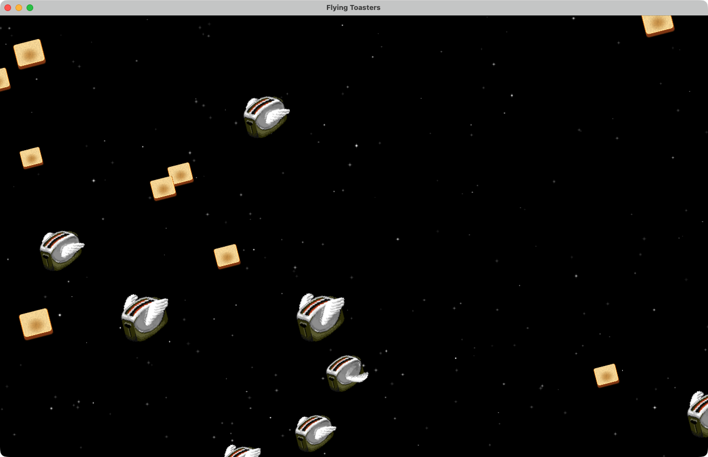

# VibingToasters

The After Dark *Flying Toasters* screensaver, rebuilt from scratch as a native macOS app
and screen saver. Metal on Apple Silicon, no Xcode project, no dependencies.



> **On macOS 26 (Tahoe), run it as the app, not the `.saver`.** Apple's screen saver host
> (`legacyScreenSaver`) intermittently shows a black screen for third-party savers, and
> nothing a saver can do fixes it. The app has a built-in full-screen mode and its own
> hot corner, and does not go through that host at all. See [Use it as a screen saver](#use-it-as-a-screen-saver-recommended)
> and its [limitations](#limitations-of-the-app-approach).

## Requirements

- Apple Silicon Mac
- macOS 13 or later
- Swift 5.9 toolchain (Xcode 15+) for building

## Use it as a screen saver (recommended)

```sh
./Tools/install-agent.sh
```

This builds the release binary, installs it as a login agent (a 🍞 appears in the menu bar),
and **turns off the system's top-right hot corner**. From then on, rest the pointer in the
top-right corner for a quarter second and the toasters take over every display. Any key,
click, scroll, or real mouse movement dismisses them.

To undo all of it — stop the agent, remove it, and set the top-right corner back to
"Start Screen Saver":

```sh
./Tools/install-agent.sh --uninstall
```

The app has three launch modes:

| Command | What it does |
| --- | --- |
| `FlyingToasters` | Background agent: menu-bar item plus the top-right hot corner |
| `FlyingToasters --saver` | Run full screen once, then quit (handy for a Shortcut or testing) |
| `FlyingToasters --window` | The original 1280×800 window. `F` toggles fullscreen, `Esc`/`Q` quits |

### Limitations of the app approach

It is **not** a system screen saver, so:

- **It does not lock your Mac.** "Require password after screen saver begins" has no effect on
  it. Anyone who dismisses it lands on your unlocked desktop.
- **No idle timer.** It starts from the hot corner or the menu-bar item only, never after N
  minutes of inactivity.
- **It does not appear in System Settings → Screen Saver**, and the system's own screen saver
  settings do not control it.
- **It only works while the agent is running.** The login agent starts it automatically, but
  if you quit it from the menu bar the hot corner does nothing until you log in again or
  re-run the install script.
- **It takes over the top-right corner.** The system hot corner is disabled for as long as the
  agent is installed. The other three corners are untouched.

## Install it as a `.saver` (unreliable on macOS 26)

```sh
./Tools/make-saver.sh --install
```

That builds a release binary, compiles the shader to a precompiled Metal library,
assembles `FlyingToasters.saver`, signs it ad-hoc, and copies it to
`~/Library/Screen Savers`. Then open **System Settings → Wallpaper → Screen Saver** and pick
*Flying Toasters* from the bottom of the list, under "Other".

To just produce the bundle without installing it:

```sh
./Tools/make-saver.sh
```

**Known problem on macOS 26.** The saver renders correctly — frames are drawn and the window
reports itself visible — yet on some runs the screen stays black. Good and black runs are
identical from inside the process, so this is a host bug, not something this code can fix. It
is a known issue for third-party savers on Tahoe
([Apple forum thread](https://developer.apple.com/forums/thread/787444)). The saver exits its
host process when a session ends, which is the community workaround; it reduces the problem
but does not remove it. In testing here, about half of hot-corner triggers still went black. Reports describe
the problem as specific to Tahoe; it has not been tested on earlier releases.

## How it works

Two front ends share one engine. The app puts an `MTKView` in a window (or, in saver mode, one full-screen window per display); the screen saver
is a `ScreenSaverView` subclass that hosts the same view as a subview. Neither front end
draws anything itself — MTKView's display link drives the renderer at 60 fps in both.

**One draw call.** Every star, toast and toaster is an instance of the same quad:
`drawPrimitives(type: .triangleStrip, vertexStart: 0, vertexCount: 4, instanceCount: N)`.
Quad corners are generated in the vertex shader from `[[vertex_id]]`, so there is no vertex
buffer and no vertex descriptor to get wrong. Layer order is instance order — stars, then
toasts, then toasters — so there is no depth buffer either.

**The toasters are real sprites.** Six 64×64 frames in a `texture2d_array`, selected per
instance by a frame index, with the wing flap driven by a per-toaster sine. The frames ship
as 4-bits-per-pixel palette data compiled into the binary; they are not drawn procedurally.

**The toasts and stars are not.** Both are generated entirely in the fragment shader — the
toast's crust ring, mottling and volume gradient are all math.

**Everything flies one direction.** The whole flock moves on a single shared vector, down and
to the left, banked at a single shared angle. Objects recycle in from the top or right edge
rather than bouncing.

**Blending is premultiplied**, so filtered sprite edges don't pick up dark fringes.

### Why there is a `.metallib` in the bundle

The standalone app compiles its shader at runtime from an inlined Swift string. The screen
saver cannot: `legacyScreenSaver` is sandboxed, and its Mach lookup exceptions cover
`CARenderServer` and `CoreDisplay` but **not** `MTLCompilerService`. Runtime shader
compilation is simply unavailable there.

So `make-saver.sh` compiles the shader ahead of time into `Contents/Resources`, and the
renderer **prefers** that library whenever one is present. Compiling from source is only a
path for the app, which ships no metallib. Getting this order wrong is not a slow path — it
is a black screen.

## Regenerating the sprites

The toaster frames are baked from the XPM sprites in
[torunar/flying-toasters-xscreensaver](https://github.com/torunar/flying-toasters-xscreensaver):

```sh
python3 Tools/BakeToasterFrames.py toaster.xpm > Sources/FlyingToastersKit/ToasterFrames.swift
```

## Tools

| File | Purpose |
| --- | --- |
| `Tools/install-agent.sh` | Install the app as a login agent owning the top-right hot corner (`--uninstall` reverts) |
| `Tools/make-saver.sh` | Build and assemble the `.saver` bundle |
| `Tools/BakeToasterFrames.py` | Bake XPM sprites into `ToasterFrames.swift` |
| `Tools/TestSaver.swift` | Load a `.saver` via `NSBundle` and host it in a window, for testing without waiting for idle |
| `Tools/winlist.swift` | Print a window's `CGWindowID`, for scripted screenshots |

`AGENTS.md` documents the architecture and the debugging playbook in more depth.

## Credits

Inspired by *After Dark*'s Flying Toasters, by Berkeley Systems (1992). The toaster sprite
artwork originates from that screensaver and was extracted by the
[torunar/flying-toasters-xscreensaver](https://github.com/torunar/flying-toasters-xscreensaver)
project, which is MIT licensed. The artwork itself belongs to Berkeley Systems; this project
is a personal reimplementation and is not affiliated with or endorsed by them.

## License

The **code** is [MIT licensed](LICENSE) — fork it, change it, ship it.

The **toaster sprite artwork is not covered by that license**, and this project has no
rights to grant over it. That applies to `Sources/FlyingToastersKit/ToasterFrames.swift` and
to `docs/screenshot.png`, which depicts the same artwork. See [NOTICE](NOTICE) for the
details, including why the upstream MIT license doesn't carry over to the images.
